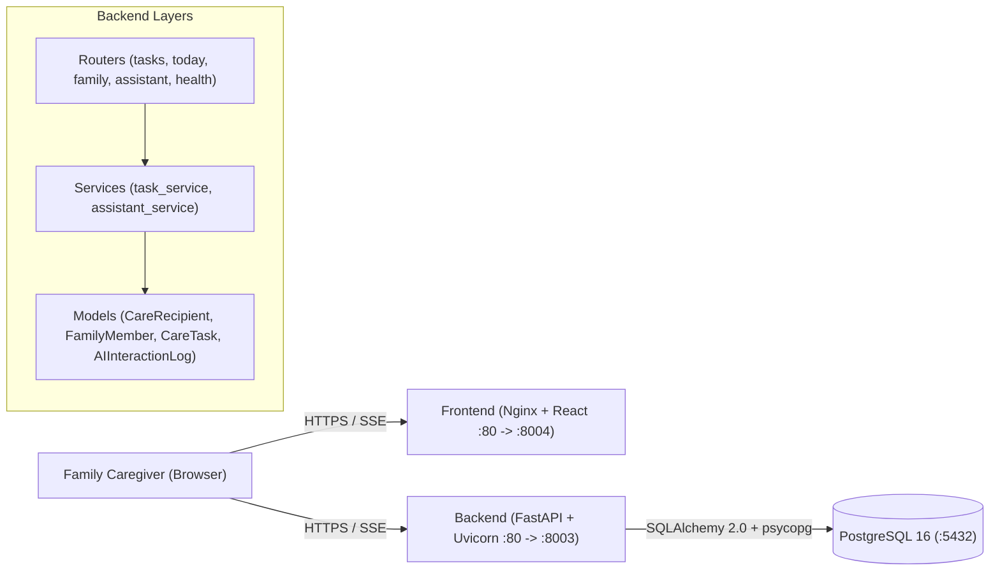

# CareCircle Lite

CareCircle Lite is a lightweight web application that helps families coordinate the daily care of an aging parent through shared care tasks, audit-tracked completion, and a streaming **"Ask about today"** assistant.

---

## Project Overview

### What CareCircle Lite Does
Families sharing caregiving responsibilities for an aging parent often rely on scattered text messages to confirm whether medications were taken, appointments were kept, or check-in calls happened. CareCircle Lite centralizes today's care schedule into a single shared dashboard where family members can:

- View **Overdue**, **Due today**, and **Completed** care tasks at a glance.
- Switch the active demo family member (`Amit`, `Priya`, `Ravi`) and mark tasks done with an immutable completion record.
- Add new medicine, appointment, or check-in tasks.
- Ask natural-language questions about today's schedule and receive progressive, context-grounded answers streamed over Server-Sent Events (SSE).

### Intended Audience
Adult children and family caregivers coordinating day-to-day care for an aging parent, built as a clean, calm family utility rather than a clinical EHR system.

### Key Features
- **Today Dashboard**: Server-grouped `overdue`, `due`, and `done` buckets computed in the configured application timezone (`APP_TIMEZONE`).
- **Dynamic Overdue Calculation**: `overdue` is never persisted as a database status; it is computed dynamically from `status = 'pending'` and `due_at < now`.
- **Concurrency-Safe Completion**: Atomic conditional SQL `UPDATE ... WHERE status = 'pending'` prevents duplicate completions and returns `HTTP 409 Conflict` if another caregiver completes the task first.
- **Streaming "Ask about today" Assistant**: `POST /api/assistant/ask` streams deterministic, context-grounded responses as SSE `token` and `done` events and logs completed interactions to PostgreSQL.
- **Responsive Minimal White UI**: Mobile-first design with `#FFFFFF` surfaces, `#171717` typography, subtle `#EAEAEA` borders, and touch-friendly controls.


## Tech Stack

| Layer | Technologies |
| --- | --- |
| **Frontend** | React 19, JavaScript (JSX), Vite 8, Tailwind CSS v4 (`@tailwindcss/vite`), Lucide React |
| **Backend** | Python 3.12, FastAPI, Uvicorn, Pydantic v2, `pydantic-settings`, SQLAlchemy 2.0, Alembic, `psycopg[binary]` |
| **Database** | PostgreSQL 16 (Docker) |
| **Streaming** | Server-Sent Events (SSE) via FastAPI `StreamingResponse` + browser `fetch()` `ReadableStream` |
| **Testing & Linting** | Pytest, `httpx`, `oxlint` |
| **Containerization** | Docker & Docker Compose |

---

## Architecture

### System Overview



### Frontend Architecture
- **Pages & Components**: `src/pages/Today.jsx` composes `Header`, `SummaryCards`, `AskTodayCard`, `TaskGroup`, `TaskCard`, `AddTaskModal`, `LoadingState`, and `EmptyState`.
- **Hooks**: `src/hooks/useToday.js` manages Today data, family-member selection (`sessionStorage`), task creation, and non-optimistic completion; `src/hooks/useAssistant.js` manages streaming assistant state and abort/retry handling.
- **API Client**: `src/services/api.js` centralizes REST calls and SSE parsing (`fetch()` + `ReadableStream` splitting on `\r?\n\r?\n` across chunk boundaries).

### Backend Architecture
- **Routers (`app/routers/`)**: Thin HTTP handlers (`health.py`, `tasks.py`, `today.py`, `family.py`, `assistant.py`) delegating business logic to services.
- **Schemas (`app/schemas/`)**: Strict Pydantic v2 validation (`extra="forbid"` on write schemas, timezone-aware UTC normalization on `due_at`).
- **Services (`app/services/`)**: `task_service.py` owns Today grouping, atomic task completion, and CRUD; `assistant_service.py` builds today's context, generates deterministic answers, streams SSE chunks, and persists interaction logs.
- **Error Handling**: Domain errors (`400`, `404`, `409`) and global `500` shielding ensure internal database errors and stack traces are never exposed in API responses.

### Database Models & Relationships
1. **`care_recipients`** (`CareRecipient`): `id` (UUID PK), `name`, `date_of_birth`, `created_at` (`TIMESTAMPTZ`).
2. **`family_members`** (`FamilyMember`): `id` (UUID PK), `care_recipient_id` (FK -> `care_recipients.id`, `ON DELETE CASCADE`), `name`, `relationship`, `created_at` (`TIMESTAMPTZ`).
3. **`care_tasks`** (`CareTask`): `id` (UUID PK), `care_recipient_id` (FK -> `care_recipients.id`, `ON DELETE CASCADE`), `title`, `description`, `task_type` (`medicine | appointment | check_in`), `due_at` (`TIMESTAMPTZ`), `status` (`pending | done`), `completed_by_id` (nullable FK -> `family_members.id`, `ON DELETE SET NULL`), `completed_at` (`TIMESTAMPTZ`), `created_at`, `updated_at`.
4. **`ai_interaction_logs`** (`AIInteractionLog`): Independent telemetry table storing `id` (UUID PK), `question`, `context_sent` (`JSONB`), `answer`, `latency_ms`, and `created_at` (`TIMESTAMPTZ`).

### SSE Streaming & Interaction Logging Flow
1. Frontend sends `POST /api/assistant/ask` with `{"question": "...", "care_recipient_id": "..."}` via `fetch()`.
2. Backend validates the request and resolves the care recipient (`404` if missing, `422` if blank).
3. `assistant_service.build_today_context()` reuses `task_service.get_today_tasks()` to build a JSON context of today's `overdue`, `due`, and `done` tasks.
4. `assistant_service.generate_answer()` produces a deterministic, context-grounded answer and `stream_assistant_response()` streams progressive `event: token` JSON chunks (`{"chunk": "..."}`).
5. Client disconnects are checked before every chunk; partial/aborted responses are **not** logged.
6. After all tokens finish streaming, `log_interaction_safely()` saves the `question`, exact `context_sent`, full `answer`, and server-measured `latency_ms` to `ai_interaction_logs`, then emits `event: done` (`{"status": "done"}`).

---

## Project Structure

```text
carecircle-lite/
├── .gitignore                   # Excludes .env, .venv, node_modules, build artifacts
├── docker-compose.yml           # PostgreSQL, FastAPI backend, and Nginx frontend services
├── README.md
├── backend/
│   ├── Dockerfile               # Runs Alembic migrations and starts Uvicorn on port 80
│   ├── alembic.ini              # Alembic configuration
│   ├── requirements.txt         # Python dependencies
│   ├── alembic/
│   │   ├── env.py               # Reads DATABASE_URL from app settings
│   │   └── versions/
│   │       └── 0001_initial_schema.py
│   └── app/
│       ├── main.py              # FastAPI app, CORS, middleware, routers
│       ├── seed.py              # Idempotent development seed script
│       ├── core/                # Settings, SQLAlchemy engine/session, UTC helper
│       ├── models/              # SQLAlchemy 2.0 ORM models
│       ├── routers/             # HTTP & SSE route handlers
│       ├── schemas/             # Pydantic v2 request/response models
│       ├── services/            # Task coordination & streaming assistant logic
│       └── tests/               # Pytest integration and unit test suite
└── frontend/
    ├── Dockerfile               # Multi-stage Vite build served by Nginx on port 80
    ├── nginx.conf               # SPA routing configuration
    ├── index.html
    ├── package.json
    ├── vite.config.js           # Tailwind v4 plugin + optional local dev proxy
    └── src/
        ├── App.jsx
        ├── index.css
        ├── components/          # Header, SummaryCards, TaskGroup, TaskCard, AddTaskModal, AskTodayCard
        ├── hooks/               # useToday, useAssistant
        ├── pages/               # Today dashboard page
        ├── services/            # Centralized REST + SSE fetch client
        └── utils/               # Date/time formatting and lateness helpers
```

---

## Setup and Running

### 1. Clone and Create `.env`

```bash
git clone https://github.com/Manish-Salavkar/CareCircle.git
cd CareCircle/carecircle-lite
```

Create a `.env` file in `carecircle-lite/` using this template:

```env
# Application
APP_NAME=CareCircle Lite
APP_ENV=development
DEBUG=false
APP_TIMEZONE=UTC

# PostgreSQL
POSTGRES_USER=carecircle
POSTGRES_PASSWORD=your_strong_postgres_password
POSTGRES_DB=carecircle_lite
POSTGRES_HOST=db
POSTGRES_PORT=5432
DATABASE_URL=postgresql+psycopg://carecircle:your_strong_postgres_password@db:5432/carecircle_lite

# Database Pool
DB_POOL_SIZE=5
DB_MAX_OVERFLOW=10
DB_POOL_TIMEOUT=30
DB_POOL_RECYCLE=1800

# Backend (container :80 -> host :8003)
BACKEND_INTERNAL_PORT=80
BACKEND_PORT=8003
CORS_ORIGINS=https://your-frontend-domain.com,http://localhost:8004

# Frontend (container :80 -> host :8004)
FRONTEND_INTERNAL_PORT=80
FRONTEND_PORT=8004
VITE_API_BASE_URL=https://your-api-domain.com
VITE_API_PROXY_TARGET=http://backend:80
```

| Variable | Purpose |
| --- | --- |
| `APP_NAME`, `APP_ENV`, `DEBUG`, `APP_TIMEZONE` | App metadata, debug flag, and timezone used for Today day boundaries (`UTC`, `Asia/Kolkata`, etc.). `app/seed.py` refuses to run when `APP_ENV=production`. |
| `POSTGRES_USER`, `POSTGRES_PASSWORD`, `POSTGRES_DB`, `POSTGRES_HOST`, `POSTGRES_PORT` | PostgreSQL container credentials and host port binding. |
| `DATABASE_URL` | Full SQLAlchemy 2.0 connection string (`postgresql+psycopg://...`). |
| `DB_POOL_SIZE`, `DB_MAX_OVERFLOW`, `DB_POOL_TIMEOUT`, `DB_POOL_RECYCLE` | SQLAlchemy connection pool tuning. |
| `BACKEND_INTERNAL_PORT`, `BACKEND_PORT` | Backend Uvicorn container port (`80`) and host port (`8003`). |
| `CORS_ORIGINS` | Comma-separated origins allowed to call the backend API (must include your frontend domain). |
| `FRONTEND_INTERNAL_PORT`, `FRONTEND_PORT` | Frontend Nginx container port (`80`) and host port (`8004`). |
| `VITE_API_BASE_URL` | Public backend URL baked into the frontend bundle at build time (e.g. `https://apicarecircle.manishsalavkar.me` or `http://localhost:8003`). |
| `VITE_API_PROXY_TARGET` | Optional proxy target when running `vite` dev server directly. |

### 2. Start with Docker Compose

```bash
docker compose up --build -d
```

The backend container automatically runs `alembic upgrade head` on startup.

### 3. Seed Initial Data (Optional, Idempotent)

```bash
docker compose exec backend python -m app.seed
```

This creates one care recipient (`Mum`), three family members (`Ravi`, `Priya`, `Amit`), and seven sample tasks (medicine, appointment, check-in, pending, completed, and overdue). Running it multiple times will not create duplicates.

### 4. Access the Application

- **Today Dashboard (Frontend):** `http://localhost:8004` (or your tunnel domain mapped to port `8004`)
- **Swagger / OpenAPI Docs:** `http://localhost:8003/docs` (or your API domain `/docs`)
- **Health Check:** `http://localhost:8003/health`

### 5. Run Tests, Lint, and Production Build

**Backend tests (inside Docker against PostgreSQL):**
```bash
docker compose exec backend pytest -v
```

**Frontend lint and production build:**
```bash
cd frontend
npm install
npm run lint
npm run build
```

---

## API Overview

| Method | Endpoint | Description |
| --- | --- | --- |
| `GET` | `/health` | Service health and environment status |
| `GET` | `/api/family-members` | List family members for a care recipient (defaults to primary recipient) |
| `GET` | `/api/today` | Return `date`, `care_recipient_id`, `care_recipient_name`, `overdue`, `due`, `done`, and `counts` |
| `GET` | `/api/tasks` | List all tasks with optional `status`, `task_type`, and `care_recipient_id` filters |
| `POST` | `/api/tasks` | Create a new `pending` care task |
| `GET` | `/api/tasks/{task_id}` | Get details for a specific task |
| `PATCH` | `/api/tasks/{task_id}` | Partially update `title`, `description`, `task_type`, or `due_at` |
| `POST` | `/api/tasks/{task_id}/complete` | Atomically mark a `pending` task `done` with `completed_by_id` and server UTC `completed_at` (`409` if already done) |
| `POST` | `/api/assistant/ask` | Stream a grounded answer about today's care schedule via SSE and log completed interactions |

---

## Design Decisions and Assumptions

- **PostgreSQL + FastAPI**: PostgreSQL provides native `UUID`, `JSONB`, `TIMESTAMPTZ`, and row-level locking for concurrency safety; FastAPI provides typed request/response validation, async SSE streaming, and automatic OpenAPI docs.
- **Dynamic Overdue Status**: Storing `overdue` in the database creates stale state as soon as the clock passes `due_at`. Persisting only `pending | done` and calculating overdue dynamically against `now_utc` keeps the source of truth accurate.
- **Atomic Conditional Task Completion**: `POST /api/tasks/{task_id}/complete` uses `UPDATE care_tasks ... WHERE id = :id AND status = 'pending' RETURNING id` so two caregivers tapping "Mark as done" concurrently cannot both succeed or overwrite the first person's completion audit fields.
- **Deterministic Template Assistant**: The assistant avoids external LLM API keys and nondeterministic hallucinations by querying today's grouped schedule and generating answers strictly from that context.
- **SSE over `POST` (`fetch` + `ReadableStream`)**: Native `EventSource` only supports `GET` requests, whereas `fetch()` with `ReadableStream` lets the client send a JSON `POST` body cleanly while progressively rendering `token` events as they arrive.
- **Demo Family Member Selector**: Authentication is intentionally omitted in this lightweight version. The header selector switches the active demo caregiver (`sessionStorage`) and passes `completed_by_id` when marking tasks done.
- **Timezone Handling**: All database timestamps (`due_at`, `completed_at`, `created_at`, `updated_at`) are stored in UTC (`TIMESTAMPTZ`). `GET /api/today` computes day boundaries in `APP_TIMEZONE` and converts them to UTC before querying PostgreSQL; the React UI formats timestamps in the user's browser timezone.

---

## Limitations and Future Improvements

- **Demo identity only**: There is no user authentication or role-based access control; the family member dropdown is a demo switcher.
- **Single-recipient default UI**: The backend supports `care_recipient_id` across endpoints, while the frontend currently displays the primary care recipient without a recipient switcher.
- **Template-based NLU**: The assistant handles common caregiver questions reliably using deterministic rules, rather than open-ended LLM reasoning.
- **Future improvements**: Add real authentication, recurring task schedules, push/SMS reminders for overdue medications, inline task editing/deletion in the UI, and an optional LLM adapter behind the existing `assistant_service` interface.

---

## Tools Used

- **Backend**: Python 3.12, FastAPI, Uvicorn, SQLAlchemy 2.0, Alembic, Pydantic v2, `psycopg`, Pytest, `httpx`
- **Frontend**: React 19, JavaScript, Vite 8, Tailwind CSS v4, Lucide React, `oxlint`
- **Infrastructure**: PostgreSQL 16, Docker, Docker Compose

---

<sub>Built with Antigravity</sub>
